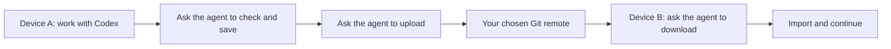

# Codex Project Transfer

**Switch computers. Pick up the conversation.**

Git carries your code between machines. Your Codex debugging sessions and design discussions deserve to travel with it. This skill saves native project sessions locally and lets your agent upload or download them when you ask.

**Check, save, and transfer only when you ask.** No hooks, background polling, or automatic saving; the plugin stays idle between requests.

[中文](README.md)

## When to use it

- Switch between computers: upload before leaving, download on the receiving device.
- Return to a long-running project with its conversations and investigation history.
- Back up sessions by project before moving to another machine.
- Keep background overhead low without finding and copying session files yourself.

## Workflow



Codex keeps its normal chat history. This plugin snapshots project sessions only when you request a check, save, upload, or sync. Setup does not save sessions or start any background work. Downloads never upload local history. Uploads read remote history first to preserve other devices' records.

Use your own private Git remote without deploying another server. A dedicated session branch keeps transfers separate from code commits. Divergent continuations are preserved.

## First use

Have Python 3.10+, Git, and Codex available. Download this project and ask your agent:

> Read `skills/codex-project-transfer/SKILL.md` in this project and install the skill.

Provide the full path if necessary. Installation prepares a **virtual environment inside the installed skill directory**. No global Python packages, activation, or PATH changes are required. The runtime source, scripts, and supporting documents are copied into that same skill folder. The original download can be removed afterward. Open a new chat when installation finishes. Native plugin bundles can ask the agent to complete installation using the bundled instructions.

## Set up your project

In the Git project, say:

> Use $codex-project-transfer to initialize this project and remember origin. Install no hooks; check, save, or transfer sessions only when I ask.

Setup is local and does not save or transfer chats. No hook configuration or trust review is needed.

**Your required actions:**

1. Complete Git authentication if prompted during a transfer.
2. Choose a repository authorized to hold full chats, including possible code and command output. A private repository is recommended.

## Everyday requests

| Ask your agent | Result |
|---|---|
| “Check and save this project's sessions.” | Create local snapshots and inspect the result, without remote access |
| “Upload this project's sessions.” | Save local project sessions and upload |
| “Download this project's sessions.” | Fetch and import, without uploading |
| “Sync both directions once.” | One upload/download operation |
| “Save locally only.” | Save without remote access |
| “Check transfer status.” | Inspect local status without transferring |
| “My imported chat is missing.” | Diagnose local restoration |

On another device, prepare the same code repository and plugin, then ask the agent to configure the project and download sessions. Failed transfers preserve local records; ask again when ready to retry.

The devices may use different model providers. Newly imported sessions use the receiving project’s provider while archived metadata and historical messages stay intact. Configure a working provider, model, and authentication on the receiving device first.

Open chats cannot safely have their history replaced. The agent will tell you when clients must close and provide the necessary follow-up. Conflicting continuations are kept for you to choose between.

Forked chats are saved with the parent history needed to restore them. If a parent is missing, re-export on the source device with the complete history available. Incomplete archives fail clearly instead of being reported as successful imports.

## Manual command-line use

You can operate the tool directly without an agent. In the examples, `/path/to/project` is the **Git project directory**, not its `.codex-chats` folder.

### 1. Install and prepare the command

If not already installed, run this once from the downloaded source repository:

```sh
# macOS / Linux
python3 scripts/install.py
```

On Windows PowerShell, use `py -3 scripts/install.py`. The complete tool and its virtual environment are installed inside the skill directory.

Define a shortcut in your current terminal. This does not install a global command or require environment activation.

macOS / Linux (bash or zsh):

```sh
CPT_SCRIPT="${CODEX_HOME:-$HOME/.codex}/skills/codex-project-transfer/scripts/cpt.py"
cpt() { python3 "$CPT_SCRIPT" "$@"; }
```

Windows PowerShell:

```powershell
$CptRoot = if ($env:CODEX_HOME) { $env:CODEX_HOME } else { Join-Path $env:USERPROFILE ".codex" }
$CptScript = Join-Path $CptRoot "skills\codex-project-transfer\scripts\cpt.py"
function cpt { py -3 $CptScript @args }
```

For a custom installation directory, point the shortcut to `scripts/cpt.py` inside the skill path returned by the installer. The shortcut lasts only for the current terminal session.

### 2. Export Codex sessions into the project

```sh
# Initialize this project once; no saving or uploading occurs
cpt -C "/path/to/project" init

# Save project sessions and required ancestry under .codex-chats/
cpt -C "/path/to/project" export

# Inspect local status without uploading or downloading
cpt -C "/path/to/project" status
```

Use `check` instead of `export` to save and report local status in one operation.

For a first transfer to another device, place the **entire `.codex-chats/` directory** under that device's corresponding Git project root. Copy the directory or carry it in Git commits you manage yourself. Do not copy only one JSONL file: forked chats may depend on other files. If both devices already have snapshots, the upload/download workflow below preserves conflicting versions.

### 3. Import project snapshots into Codex

Install the tool on the receiving device and prepare its project and Codex provider configuration:

```sh
# Preview the plan without writing session records
cpt -C "/path/to/project" import --dry-run

# Import, register, and verify the sessions
cpt -C "/path/to/project" import
```

These commands read the project's existing `.codex-chats/`; they do not download from a remote. Select the imported chat in Codex, or resume an ID returned by the tool:

```sh
codex -C "/path/to/project" resume SESSION_ID
```

The destination project's effective provider is used by default. To select one explicitly, such as `crs`:

```sh
cpt -C "/path/to/project" --provider crs import
```

Global options such as `-C`, `--provider`, and `--home` precede the subcommand. Use `--home` for a different Codex data directory.

### 4. Transfer through a Git remote

On each device, remember an existing authorized remote once:

```sh
cpt -C "/path/to/project" init --remote origin
```

Choose the operation you need:

```sh
# Sending device: save local project sessions and upload
cpt -C "/path/to/project" upload

# Receiving device: download and import without uploading local sessions
cpt -C "/path/to/project" download

# Current device: synchronize both directions once
cpt -C "/path/to/project" sync
```

Transfers use the remote's dedicated `codex-sessions` branch without automatically committing project code. Every command is a single operation.

### 5. Pending updates, conflicts, and errors

- `pending`: the snapshots contain additional history. **Close Codex, ChatGPT desktop, and VS Code**, then run `cpt -C "/path/to/project" import --update-existing`. Original records are backed up before appending. This option does not overwrite divergent histories.
- `conflicts`: both histories have diverged. Preserve both and ask the agent to inspect their differences; do not splice JSONL manually.
- Missing parent history: re-export complete history on the source device. Repeated imports cannot recreate missing records.
- Files imported but registration failed: inspect the warnings, address their cause, then retry with `cpt -C "/path/to/project" reconcile`.

Output is JSON. Inspect `warnings`, `pending`, `conflicts`, and `native.verified`. A nonzero exit code means failure or outstanding work; an `imported` entry alone does not prove restoration completed.

## Availability

Native chat history is transferred; code, external attachments, credentials, and running processes are not. CLI restoration is verified on macOS. Desktop/VS Code GUI continuation and Windows/Linux real-device use still need validation. Ordinary ChatGPT web history is outside scope.

Install separately on each device; its virtual environment is created inside the skill folder.
