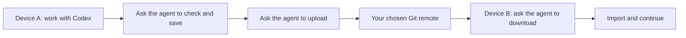

# Codex Project Transfer

**Switch computers. Pick up the conversation.**

Git carries your code between machines. Your Codex debugging sessions and design discussions deserve to travel with it. This skill saves native project sessions locally and lets your agent upload or download them when you ask.

**Check, save, and transfer only when you ask.** No hooks, background polling, or automatic saving; the plugin stays idle between requests.

[中文](README.md)

## When to use it

- Switch between computers: upload before leaving, download on the receiving device.
- Return to a long-running project with its conversations and investigation history.
- Back up sessions by project before moving to another machine.
- Keep background overhead low without finding and copying session files yourself.

## Workflow



Codex keeps its normal chat history. This plugin snapshots project sessions only when you request a check, save, upload, or sync. Setup does not save sessions or start any background work. Downloads never upload local history. Uploads read remote history first to preserve other devices' records.

Use your own private Git remote without deploying another server. A dedicated session branch keeps transfers separate from code commits. Divergent continuations are preserved.

## First use

Have Python 3.10+, Git, and Codex available. Download this project and ask your agent:

> Read `skills/codex-project-transfer/SKILL.md` in this project and install the skill.

Provide the full path if necessary. Installation prepares a **virtual environment inside the installed skill directory**. No global Python packages or environment activation are required. The runtime source, scripts, and supporting documents are copied into that same skill folder. The original download can be removed afterward. Open a new chat when installation finishes. Native plugin bundles can ask the agent to complete installation using the bundled instructions.

## Set up your project

In the Git project, say:

> Use $codex-project-transfer to initialize this project and remember origin. Install no hooks; check, save, or transfer sessions only when I ask.

Setup is local and does not save or transfer chats. No hook configuration or trust review is needed.

**Your required actions:**

1. Complete Git authentication if prompted during a transfer.
2. Choose a repository authorized to hold full chats, including possible code and command output. A private repository is recommended.

## Everyday requests

| Ask your agent | Result |
|---|---|
| “Check and save this project's sessions.” | Create local snapshots and inspect the result, without remote access |
| “Upload this project's sessions.” | Save local project sessions and upload |
| “Download this project's sessions.” | Fetch and import, without uploading |
| “Sync both directions once.” | One upload/download operation |
| “Save locally only.” | Save without remote access |
| “Check transfer status.” | Inspect local status without transferring |
| “My imported chat is missing.” | Diagnose local restoration |

On another device, prepare the same code repository and plugin, then ask the agent to configure the project and download sessions. Failed transfers preserve local records; ask again when ready to retry.

The devices may use different model providers. Newly imported sessions use the receiving project’s provider while archived metadata and historical messages stay intact. Configure a working provider, model, and authentication on the receiving device first.

Open chats cannot safely have their history replaced. The agent will tell you when clients must close and provide the necessary follow-up. Conflicting continuations are kept for you to choose between.

Forked chats are saved with their required parent history, including native history version files. A new Git repository needs no preloaded ancestry: export collects it from the local Codex data directory. If a source file is genuinely missing, CPT identifies the affected chats.

## Manual command-line use

You can operate the tool directly without an agent. The path is the **Git project directory**, not its `.codex-chats` folder. The common commands are simply `cpt export ./` and `cpt import ./`.

### 1. Install the `cpt` command

On macOS / Linux, run once from the downloaded repository:

```sh
python3 scripts/install.py --link-dir "$HOME/.local/bin"
cpt --version
```

All program files and the virtual environment stay inside the skill folder. `~/.local/bin/cpt` is only a link to its launcher. If that directory is not on PATH, enable it for the current terminal:

```sh
export PATH="$HOME/.local/bin:$PATH"
```

Add the directory to your shell PATH configuration for future terminals. The installer preserves unrelated existing `cpt` commands.

On Windows PowerShell:

```powershell
$CptInstall = (py -3 scripts/install.py | Out-String) | ConvertFrom-Json
$env:Path = "$($CptInstall.command_directory);$env:Path"
cpt --version
```

The Windows launcher is `bin\cpt.cmd` inside the installed skill. The PATH assignment affects only this terminal; add the returned `command_directory` to your user PATH to use it in new terminals.

Then call `cpt` directly without activating `.venv`. Run the examples from your project directory: `./` means the current directory, or use an explicit path such as `"/path/to/project"`. Omitting the path also selects the current directory, for example `cpt import`.

### 2. Export Codex sessions into the project

```sh
# Initialize this project once; no saving or uploading occurs
cpt init ./

# Save project sessions and required ancestry under .codex-chats/
cpt export ./

# Inspect local status without uploading or downloading
cpt status ./
```

Use `check` instead of `export` to save and report local status in one operation.

Export stops by default if any chat lacks required ancestry. To save the remaining complete chats explicitly:

```sh
cpt export ./ --skip-incomplete
```

`skipped` lists each omitted chat ID and reason. Skipping returns exit code `2`, meaning partial completion. This option also applies to the export step of `check`, `upload`, and `sync`. It does not delete native chats or existing archive snapshots, and cannot repair an already incomplete archive.

For a first transfer to another device, place the **entire `.codex-chats/` directory** under that device's corresponding Git project root. Copy the directory or carry it in Git commits you manage yourself. Do not copy only one JSONL file: forked chats may depend on other files. If both devices already have snapshots, the upload/download workflow below preserves conflicting versions.

### 3. Import project snapshots into Codex

Install the tool on the receiving device and prepare its project and Codex provider configuration:

```sh
# Preview the plan without writing session records
cpt import ./ --dry-run

# Import, register, and verify the sessions
cpt import ./
```

These commands read the project's existing `.codex-chats/`; they do not download from a remote. Import restores saved generated titles and manual names. Export again to capture later title changes without recreating the archive. Titles on existing chats are restored too, without requiring `--update-existing`.

**If the open ChatGPT desktop / Codex desktop app does not show the imported chats or titles, refresh its list manually; restart the client if they remain absent.** CPT reports this in `native.ui_refresh` and never quits, restarts, or controls the client in the background. `native.verified` confirms native discovery, not that the current window has refreshed its cache.

Select the imported chat in Codex, or resume an ID returned by the tool:

```sh
codex resume SESSION_ID
```

The destination project's effective provider is used by default. To select one explicitly, such as `crs`:

```sh
cpt import ./ --provider crs
```

Options such as `--provider` and `--home` can follow the subcommand. Use `--home` for a different Codex data directory.

### 4. Transfer through a Git remote

On each device, remember an existing authorized remote once:

```sh
cpt init ./ --remote origin
```

Choose the operation you need:

```sh
# Sending device: save local project sessions and upload
cpt upload ./

# Receiving device: download and import without uploading local sessions
cpt download ./

# Current device: synchronize both directions once
cpt sync ./
```

Transfers use the remote's dedicated `codex-sessions` branch without automatically committing project code. Every command is a single operation.

### 5. Pending updates, conflicts, and errors

- `pending`: the snapshots contain additional history. **Close Codex, ChatGPT desktop, and VS Code**, then run `cpt import ./ --update-existing`. Original records are backed up before appending. This option does not overwrite divergent histories.
- `conflicts`: both histories have diverged. Preserve both and ask the agent to inspect their differences; do not splice JSONL manually.
- Missing parent during export: verify that `--home` selects the correct Codex data directory, then recover the named history file from the original device or a backup. Use `--skip-incomplete` to export other complete chats first.
- Missing parent during import: re-export on the source device and carry the entire `.codex-chats/` directory. Repeated imports cannot recreate missing records.
- Files imported but registration failed: inspect the warnings, address their cause, then retry with `cpt reconcile ./`.

`titles_updated` in export lists saved or updated names; `native.titles_restored` in import lists names whose restoration was verified. `--no-reconcile` skips native title restoration and verification; run `cpt reconcile ./` later to finish.

Output is JSON. Inspect `skipped`, `warnings`, `pending`, `conflicts`, and `native.verified`. A nonzero exit code means failure or outstanding work; an `imported` entry alone does not prove restoration completed.

## Availability

Native chat history is transferred; code, external attachments, credentials, and running processes are not. CLI restoration is verified on macOS. Desktop/VS Code GUI continuation and Windows/Linux real-device use still need validation. Ordinary ChatGPT web history is outside scope.

Install separately on each device; its virtual environment is created inside the skill folder.
