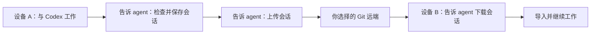

# Codex Project Transfer

**换台电脑，接着聊你的项目。**

代码可以用 Git 带走，和 Codex 一起排查问题、讨论方案的聊天也值得保存。Codex Project Transfer 将项目的原生会话保存在本地，在你需要时通过 Git 上传或下载，让另一台设备可以导入后继续工作。

它以 skill 的方式交给 agent 使用。**检查、保存和传输，都由你说了算。** agent 会选择命令、处理路径并检查结果；没有钩子、后台轮询或自动保存，平时不运行。

[English](README.en.md)

## 适合什么场景

- **多台电脑切换开发**：离开一台电脑前上传，到另一台电脑后下载。
- **长周期项目**：回来时找回之前的聊天、工具记录和排查过程。
- **换机备份**：按项目保存会话，在新设备准备好代码后恢复。
- **希望减少后台开销**：按需传输，不用持续轮询，也不用手动寻找会话文件。

## 工作流程



Codex 仍会正常保留自己的聊天历史；只有你要求检查、保存或上传时，本插件才将项目会话保存到仓库目录。**保存、上传、下载和双向同步都由你的指令触发**，配置项目不会启动后台任务。下载不会把本机记录上传；上传会先读取远端历史以保留其他设备的记录。

记录可以使用自己的私有 Git 远端存放，无需额外部署同步服务器。会话传输使用独立分支，不会替你提交代码；两端分别续聊发生分叉时，会保留双方记录。

## 第一次使用

准备好 Python 3.10+、Git 和 Codex，下载本项目，然后告诉 agent：

> 请读取这个项目里的 `skills/codex-project-transfer/SKILL.md`，安装这个技能。

如果 agent 没有打开本项目，请提供该文件的完整路径。安装器会准备**skill 目录内的局部虚拟环境**，无需全局安装 Python 包或手动激活环境。运行代码、脚本和说明文件也会一并复制到该 skill 文件夹，安装后可以移除下载的原项目目录。完成后打开一个新聊天。

如果已通过支持该插件的管理器安装，让 agent 按附带技能的说明完成安装即可。

## 设置你的项目

在工作的 Git 项目中告诉 agent：

> 使用 $codex-project-transfer，初始化当前项目，远端使用 origin。不要安装钩子，只有我要求检查、保存或传输时才操作。

agent 会完成本地设置并记住远端，不会立即保存、上传或下载。无需配置或信任钩子。

**你需要亲自完成：**

1. 首次传输时，如果 Git 要求登录，完成认证。
2. 选择允许存放完整聊天内容的仓库。聊天可能包含代码和命令输出，建议使用私有仓库。

## 日常这样说

| 你对 agent 说 | 它会做什么 |
|---|---|
| “检查并保存当前项目的会话。” | 生成本地快照并检查结果，不访问远端 |
| “上传当前项目的会话。” | 保存本机项目会话并上传 |
| “下载这个项目的会话。” | 读取远端并导入，不上传本机记录 |
| “现在双向同步一次。” | 执行一次上传和下载 |
| “只保存到本地。” | 保存记录，不访问远端 |
| “检查同步状态。” | 查看本地状态，不发起传输 |
| “导入的聊天没有显示，帮我检查。” | 检查本机恢复结果 |

切换设备时，在新设备准备好同一个代码仓库和本插件，然后让 agent 配置项目并下载会话即可。传输失败后会保留本地记录，你可以稍后再告诉 agent 重试。

两台设备可以使用不同的 model provider。新会话导入时会采用接收端项目的 provider，原始存档和历史消息保持不变；请先在接收端配置好可用的 provider、模型和登录信息。

**正在打开的聊天不能直接替换历史。** 如果已有会话需要更新，agent 会提示你关闭相关客户端，并提供必要的后续操作。发生分叉时，两份记录都会保留，由你决定继续哪一份。

分叉会话会连同恢复所需的父历史一起保存，包括 Codex 保存的历史版本文件。新建 Git 仓库不需要预先放入父历史，导出时会从本机 Codex 数据目录收集。若源文件确实缺失，工具会列出受影响的会话。

## 手动使用命令行

也可以直接在终端操作，不经过 agent。路径参数指 **Git 项目目录**，不是 `.codex-chats` 目录。最常用的形式就是 `cpt export ./` 和 `cpt import ./`。

### 1. 安装 `cpt` 命令

macOS / Linux：在下载的本项目目录中执行一次：

```bash
python3 scripts/install.py --link-dir "$HOME/.local/bin"
cpt --version
```

程序、启动脚本和虚拟环境全部位于 skill 文件夹；`~/.local/bin/cpt` 只是指向其中启动入口的链接。如果该目录尚未加入 PATH，当前终端可以执行：

```bash
export PATH="$HOME/.local/bin:$PATH"
```

需要长期生效时，将该目录加入你的 shell PATH 配置。安装器不会覆盖已有的其他 `cpt` 命令。

Windows PowerShell：

```powershell
$CptInstall = (py -3 scripts/install.py | Out-String) | ConvertFrom-Json
$env:Path = "$($CptInstall.command_directory);$env:Path"
cpt --version
```

Windows 的启动入口是 skill 文件夹内的 `bin\cpt.cmd`。以上 PATH 设置只影响当前终端；要在新终端直接使用，将安装器返回的 `command_directory` 加入用户 PATH。

安装完成后直接使用 `cpt`，无需激活 `.venv`。下面的示例在项目目录中执行，`./` 表示当前目录；也可替换成 `"/path/to/project"`。省略路径同样使用当前目录，例如 `cpt import`。

### 2. 从 Codex 导出到项目

```bash
# 首次使用该项目时初始化，不会上传或保存会话
cpt init ./

# 将项目会话及所需父历史保存到项目的 .codex-chats/
cpt export ./

# 查看本地状态，不上传或下载
cpt status ./
```

如果想一次完成“保存并检查结果”，可用 `check` 代替 `export`。

如果部分会话确实缺少父历史，默认导出会停止。要先保存其余完整会话，可显式运行：

```bash
cpt export ./ --skip-incomplete
```

结果中的 `skipped` 会列出跳过的会话 ID 和原因；发生跳过时退出码为 `2`，表示部分完成。该选项也适用于 `check`、`upload` 和 `sync` 的导出步骤，不会删除原生会话或仓库里已有的快照，也不能修复已有的不完整存档。

首次搬到另一台设备时，将**整个 `.codex-chats/` 文件夹**放到那台设备的对应 Git 项目根目录。可以通过文件复制或自己管理的 Git 提交携带；不要只拷贝单个 JSONL，分叉会话可能依赖其他文件。两端都已有会话快照时，可使用下方的上传/下载流程来保留冲突版本。

### 3. 从项目导入到 Codex

在接收设备安装好本工具，并准备好目标项目和 Codex 的 provider 配置，然后运行：

```bash
# 预览导入计划，不写入会话记录
cpt import ./ --dry-run

# 正式导入，并进行原生登记与校验
cpt import ./
```

这两条命令使用项目中已有的 `.codex-chats/`，不会从 Git 远端下载。导入会恢复存档中的自动生成标题和手动命名；再次导出会更新已变化的标题，无需重新创建会话存档。已有会话的标题也会恢复，不要求使用 `--update-existing`。

**如果已打开的 ChatGPT 桌面端 / Codex 桌面端没有显示新会话或标题，请手动刷新列表；仍未显示时重启客户端。** CPT 会在 `native.ui_refresh` 中提示，不会自动退出、重启或后台控制客户端。`native.verified` 只表示原生服务确认了会话，不代表当前窗口的缓存已刷新。

完成后，可以在 Codex 中选择会话，或使用返回的会话 ID：

```bash
codex resume SESSION_ID
```

默认读取接收端项目的有效 provider。如需显式指定，例如 `crs`：

```bash
cpt import ./ --provider crs
```

`--provider`、`--home` 可直接写在子命令后。`--home` 用于指定其他 Codex 数据目录。

### 4. 通过 Git 远端传输

如果希望工具负责传输，在两台设备上分别配置一次已存在的远端：

```bash
cpt init ./ --remote origin
```

然后按需选择操作：

```bash
# 发送设备：先保存本机项目会话，再上传
cpt upload ./

# 接收设备：下载并导入，不上传本机会话
cpt download ./

# 当前设备：执行一次双向同步
cpt sync ./
```

传输使用远端的独立 `codex-sessions` 分支，不会自动提交项目代码。这些命令都是单次执行。

### 5. 待更新、冲突和错误

- 返回 `pending`：文件中有可追加的历史。**先关闭 Codex、ChatGPT 桌面端和 VS Code**，再运行 `cpt import ./ --update-existing`。工具会备份原记录后追加；这个选项不会强行覆盖分叉。
- 返回 `conflicts`：双方历史已经分叉。先保留两份，请 agent 检查差异；不要手动拼接 JSONL。
- 导出提示缺少父历史：确认 `--home` 指向正确的 Codex 数据目录，并从原设备或备份恢复报错中的历史文件；也可用 `--skip-incomplete` 先导出其余完整会话。
- 导入提示缺少父历史：从原设备重新导出并携带整个 `.codex-chats/`。反复导入无法补出缺失内容。
- 文件已导入但登记失败：检查警告，修复原因后运行 `cpt reconcile ./` 重试校验。

导出结果中的 `titles_updated` 列出本次保存或更新的标题，导入结果中的 `native.titles_restored` 列出已验证恢复的标题。使用 `--no-reconcile` 会跳过原生标题恢复与校验；之后可运行 `cpt reconcile ./` 完成。

命令输出为 JSON。检查 `skipped`、`warnings`、`pending`、`conflicts` 和 `native.verified`；非零退出码表示失败或仍有待处理事项，不能只看到 `imported` 就认为恢复完成。

## 使用范围

- 同步的是原生 Codex 会话；代码、外部附件、登录凭据和运行中的程序需要另行处理。
- 已验证 macOS 上 Codex CLI 的历史恢复。桌面 App、VS Code 的实际界面续聊，以及 Windows/Linux 实机使用仍待验证。
- 普通 ChatGPT 网页聊天不在支持范围内。
- 每台设备单独安装，局部虚拟环境会在 skill 文件夹内创建。
